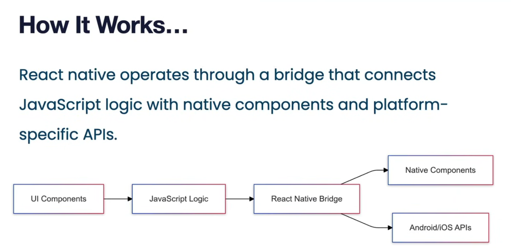
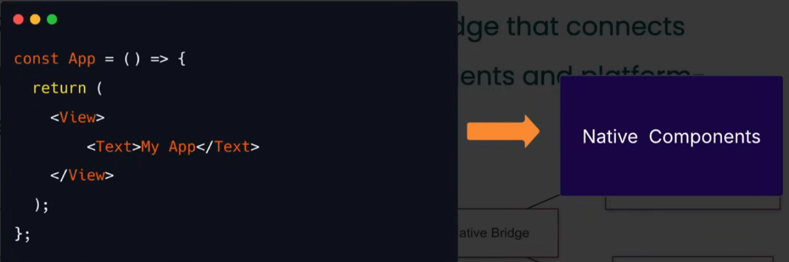
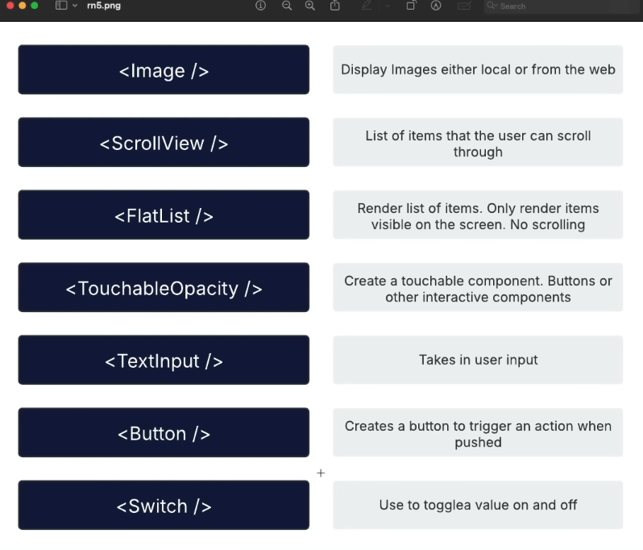
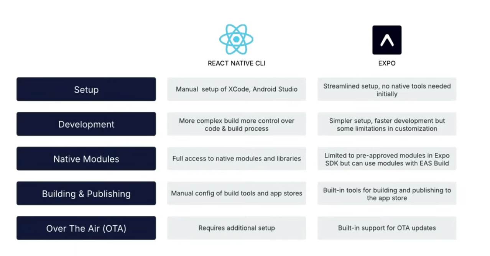

# Notes App

A cross-platform notes app built with React Native and Expo. Users can create an account, sign in, and create, edit, and delete notes stored with Appwrite.

## App link

Download the [Android build on Expo](https://expo.dev/accounts/fastwithkamran/projects/notes-app/builds/c3eda926-6ce5-49c9-9134-4d2f25836f2d), or scan the QR code:

<p align="center">
  <a href="https://expo.dev/accounts/fastwithkamran/projects/notes-app/builds/1f83f327-c80f-4e82-bca2-c32641cbc345">
    
  </a>
</p>

## Tech stack

- **React Native** provides native UI components for Android and iOS.
- **Expo** provides the development tools and services used to run and build the app.
- **Expo Router** handles file-based navigation. Routes are defined in `src/app`.
- **Appwrite** provides authentication and database services.
- **JavaScript and JSX** are used to write the app's screens and components.

## React Native basics

- **Components:** Reusable functions that return UI. For example, `NoteList` and `NoteItem` render the notes interface.
- **JSX:** A JavaScript syntax for describing UI. React Native uses components such as `<View>` and `<Text>` instead of HTML elements like `<div>` and `<p>`.
- **Props:** Values passed from a parent component to a child component, such as a note or an event handler.
- **State:** Data that changes over time and updates the UI when it changes. The app uses React's `useState` hook for values such as the note list and modal visibility.
- **Hooks and effects:** Hooks such as `useState` and `useEffect` manage component state and side effects, including loading notes when a user signs in.
- **Styles:** `StyleSheet.create` defines styles in JavaScript. Layout commonly uses Flexbox; React Native styles are not CSS files.
- **Navigation:** Expo Router maps files under `src/app` to screens and routes.
- **Shared state and services:** React Context shares authentication state across screens. Service modules keep Appwrite requests separate from screen UI.

<table>
  <tr>
    <td align="center"></td>
    <td align="center"></td>
  </tr>
  <tr>
    <td align="center"></td>
    <td align="center"></td>
  </tr>
</table>

## Get started

Install dependencies and start the Expo development server:

```bash
npm install
npx expo start
```

Open the app using the QR code in Expo Go, or run one of the platform scripts:

```bash
npm run android
npm run ios
npm run web
```

An Android emulator or iOS simulator must be installed and running for the corresponding simulator command.

## Build the Android app

From the project folder, run this command to start an Android build with EAS:

```bash
eas build --platform android
eas build --platform android --profile preview
```

If EAS asks you to sign in, follow the prompts in the terminal. When the build finishes, Expo provides a link to download the app.
